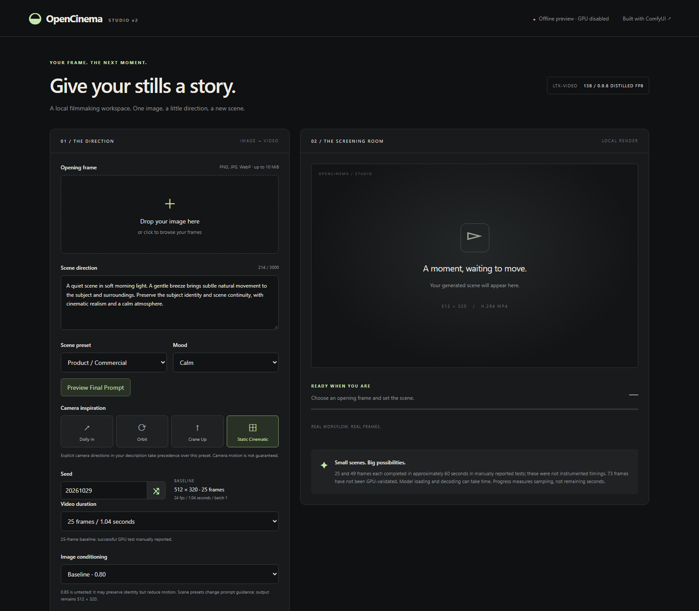
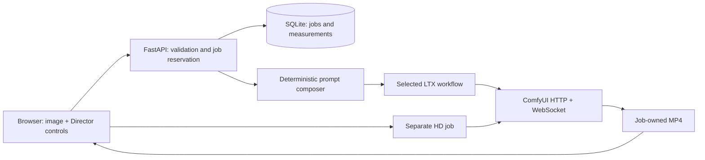

# OpenCinema Studio v2

**Give your stills a story.** A local image-to-video workspace with AI Director controls, real ComfyUI execution, and a separate HD export stage. Built with Python and FastAPI around **LTX-Video 13B v0.9.8 Distilled FP8**, developed on an **NVIDIA RTX 3060 with 12 GB VRAM**.

[Repository](https://github.com/karatarassul4-max/opencinema-studio) · [Release notes](docs/V2-RELEASE.md) · [Architecture](docs/V2-ARCHITECTURE.md) · [License](LICENSE)

## Demo and screenshots

**Final demo video:** _DEMO_VIDEO_URL — to be added after the final recording._



The screenshot shows the real v2 interface with offline fixture data, GPU disabled and no generated media. It illustrates the application, not an inference result. The older neutral v1 screenshot remains in the repository as historical material.

### Cinematic Smoke Reveal

The demonstration concept uses an owned or licensed opening image, a smoke-reveal description, camera guidance, and a short MP4 followed by optional HD export. It is intended to show the complete user flow for the Open Source Higgsfield Challenge: preview the final prompt, generate a scene, inspect the result and export it. The final recording and output-quality evidence are pending; the repository does not include a generated demo video or claim a verified smoke trajectory.

## Features

- **Image to video:** upload PNG, JPEG or WebP; enter a prompt; choose a seed, conditioning strength and duration; preview/download H.264 MP4.
- **AI Director:** deterministic scene, mood and lighting guidance, Dolly / Orbit / Crane / Static presets, and a read-only final-prompt preview. Explicit camera wording in your description takes precedence. Camera presets are prompt-based suggestions, **not guaranteed trajectories**; there is no hosted LLM dependency.
- **HD Export:** a separate RealESRGAN workflow, persisted job status, output ownership/dimension/frame checks and an HD download link. A standard 512×320 result targets 1280×800. The button enables immediately on a completed generation when inference is enabled; source metadata is checked by the backend before submission.
- **Recovery:** SQLite reservations, ComfyUI HTTP history/queue reconciliation and WebSocket progress, including ambiguous-submission recovery without automatically duplicating work.
- **Performance history:** requested/observed frame counts, total elapsed time, explicitly approximate execution/queue timing and optional device-wide GPU observations. Missing values remain unavailable, not zero.
- **Safeguards:** bounded uploads and image dimensions, exact duration/strength allowlists, one active Studio GPU job, busy-ComfyUI checks, same-origin POST checks and an offline default.

## Duration and render settings

| Frames | Nominal duration at 24 FPS | Evidence / intended use |
|---|---:|---|
| 25 | 1.04 s | Baseline; earlier successful GPU run manually reported |
| 49 | 2.04 s | Experimental; earlier successful GPU run manually reported |
| 73 | 3.04 s | Experimental; GPU feasibility not established by this release audit |
| 97 | 4.04 s | Experimental; GPU feasibility not established by this release audit |

The UI supports clips **up to approximately 4 seconds**, not an assurance that every option fits every GPU. Standard output is 512×320, 24 FPS, batch 1. Conditioning strength is 0.80 or 0.85; 0.85 is experimental. Eight sampling steps are standard; a separate six-step experiment is selectable only at 97 frames. Scene/camera/mood presets change prompt guidance, not output resolution.

No GPU generation was run to publish this release. Earlier roughly 60-second observations for 25/49 frames were manually reported, not instrumented benchmarks; they are not speed promises. The application records new timings when you run it.

## Technology and architecture

Python 3.11 · FastAPI / Uvicorn · SQLite · HTTPX / WebSockets · Pillow · vanilla JavaScript / CSS · ComfyUI · LTX-Video · RealESRGAN · FFmpeg/ffprobe



The Studio Python environment is separate from ComfyUI. See [architecture and recovery](docs/V2-ARCHITECTURE.md) for the state machine and deployment boundary.

## Hardware and prerequisites

Development hardware: RTX 3060 12 GB VRAM. This is a development reference, not a universal minimum or guarantee for 73/97-frame or HD workloads. ComfyUI model loading, other GPU applications and input duration affect memory use. HD upscale may process a batch of frames and can also run out of memory. Allow sufficient system RAM, commit capacity and disk space for models, uploads and generated outputs; no automatic retention policy is implemented.

Install Git and Python 3.11 for Studio, Node.js 22 for the offline JavaScript checks, and FFmpeg/ffprobe for video metadata inspection (ffprobe is required for HD validation). Maintain your existing working ComfyUI environment separately; installing Studio does not install CUDA, torch, checkpoints or custom nodes.

## Installation

The documented development directory is `D:\comguopensource-v2`; another writable clone directory is supported. Do not overwrite an existing working tree or the legacy v1 directory.

```powershell
git clone https://github.com/karatarassul4-max/opencinema-studio.git D:\comguopensource-v2
cd D:\comguopensource-v2
py -3.11 -m venv .venv
.\.venv\Scripts\python.exe -m pip install -r requirements-lock.txt
```

Until the v2 pull request is merged, check out `release/opencinema-studio-v2` after cloning. `requirements.txt` pins direct dependencies; `requirements-lock.txt` records the full pinned application environment. Neither installs ComfyUI packages. This release was checked with Python 3.11.9 and Node.js 22.20.0 on Windows; a fresh dependency installation was not performed during publication.

## ComfyUI and model setup

Prepare ComfyUI independently using its upstream instructions. Studio defaults to `http://127.0.0.1:8189` and does not start or stop ComfyUI.

Required generation assets, as referenced by the checked-in graphs:

| Asset | Expected filename / provider |
|---|---|
| Checkpoint (with VAE output) | `ltxv-13b-0.9.8-distilled-fp8.safetensors` from [Lightricks](https://huggingface.co/Lightricks/LTX-Video) |
| Text encoder | `t5xxl_fp8_e4m3fn_scaled.safetensors` from [ComfyUI text encoders](https://huggingface.co/comfyanonymous/flux_text_encoders) |
| LTX workflow nodes | [ComfyUI-LTXVideo](https://github.com/Lightricks/ComfyUI-LTXVideo), including `LTXVBaseSampler`, `STGGuiderAdvanced` and `Set VAE Decoder Noise` |
| Video I/O | [VideoHelperSuite](https://github.com/Kosinkadink/ComfyUI-VideoHelperSuite), including `VHS_VideoCombine`; HD also requires `VHS_LoadVideoPath` |
| Optional HD model | `RealESRGAN_x4plus.pth` from [Real-ESRGAN](https://github.com/xinntao/Real-ESRGAN), exposed by ComfyUI's UpscaleModelLoader |

Install assets into your own ComfyUI model directories according to upstream instructions and license terms. This repository distributes no weights and does not automatically download them. Import/inspect `workflows/ltx13b-v2-api.json` and ensure all required nodes are available before enabling inference. Exact custom-node compatibility on another installation still needs verification; do not blindly upgrade a working GPU environment.

HD uses a source MP4 filesystem path, so Studio and ComfyUI must share access to that path (the developed setup is on one Windows machine). Remote ComfyUI may work for HTTP-upload generation, but HD is not portable to a remote host without deliberate shared-path handling. No automatic network share is configured.

## Configuration and launch

Configuration is read from the process environment; `.env` files are **not automatically loaded**.

| Variable | Default | Purpose |
|---|---|---|
| `OPENCINEMA_V2_COMFY_URL` | `http://127.0.0.1:8189` | ComfyUI endpoint |
| `OPENCINEMA_V2_ENABLE_INFERENCE` | `0` | Set to `1` only when ready to submit GPU jobs |
| `OPENCINEMA_V2_DATA` | `<project>/artifacts/studio` | Must resolve to a subdirectory of this clone; keeps v2 data separate |
| `OPENCINEMA_V2_GPU_MONITOR` | `0` | Optional read-only device telemetry; polling can miss peaks and includes other applications |
| `UVICORN_HOST` | `127.0.0.1` in the launcher | Backend bind address |
| `UVICORN_PORT` | `8001` in the launcher | Backend port |

Start with the offline preview:

```powershell
cd D:\comguopensource-v2
$env:OPENCINEMA_V2_COMFY_URL = "http://127.0.0.1:8189"
$env:OPENCINEMA_V2_ENABLE_INFERENCE = "0"
$env:UVICORN_HOST = "127.0.0.1"
$env:UVICORN_PORT = "8001"
.\scripts\start-v2.ps1
```

Open **http://127.0.0.1:8001**. Use exactly **one Uvicorn worker**. To generate, launch your own instance with inference set to `1` after confirming ComfyUI is ready. Do not start a second backend on a port already used by your demo.

An optional private-demo mode exists through `OPENCINEMA_V2_PUBLIC_HOST`, `OPENCINEMA_V2_DEMO_USER` and `OPENCINEMA_V2_DEMO_PASSWORD`. It requires one exact hostname and a password of at least 20 characters; all routes are protected by Basic Auth in that mode. Supply secrets privately at runtime, use HTTPS in front of it and never commit credential values. This is a single-user demonstration system, not a hardened multi-tenant hosted service. No tunnel, proxy or service deployment is performed by the release.

## Generate and export

1. Upload an owned/licensed image (PNG/JPEG/WebP, up to 10 MiB and 20 megapixels).
2. Describe the scene, choose scene/mood/camera guidance, strength, seed and duration. Preview the final prompt before submitting.
3. Generate with inference enabled. Sampling progress is not a time estimate; 100% means an MP4 was retrieved.
4. Preview or download the original. **Export HD** becomes available immediately on completion; the server checks eligibility and reserves a separate job.
5. Download HD once validated. HD preserves the inspected source frame rate/count and aspect ratio, targeting width 1280 (1280×800 for standard output). It is an upscale, not native high-resolution LTX generation or temporal interpolation.

Do not submit directly from another ComfyUI client concurrently. Studio rejects its own overlapping jobs, but cannot prevent a different client from using the same GPU. Recovery relies on retained ComfyUI queue/history. A lost ambiguous request is reconciled rather than blindly resubmitted.

## Tests and release validation

```powershell
$env:PYTEST_DISABLE_PLUGIN_AUTOLOAD = "1"
.\.venv\Scripts\python.exe -B -m pytest -q -p no:cacheprovider
node --check app/static/app.js
node tests/test_frontend_duration.cjs
```

**215 Python tests passed**, plus the offline JavaScript duration/HD-state harness. Tests use fake ComfyUI/HTTP transports, disable inference/monitoring and block external socket connections. Test data lives under ignored `artifacts/offline-tests`; the harness never uses the live demo database. HD tests fake ffprobe and validate success, duplicate protection, wrong output metadata and unsafe output paths. One upstream Starlette/AnyIO deprecation warning remains. See [release validation](docs/V2-RELEASE.md).

## Engineering lessons

- Persist a reservation before submission; a dropped HTTP response does not prove that ComfyUI rejected the job.
- Keep camera guidance explicit and inspectable; a prompt preset cannot promise geometric control.
- Distinguish requested durations from observed video metadata, and measured wall time from approximate event-derived timing.
- Derive button state from the newest job before asynchronous refreshes. Stale HD responses must not overwrite a newly selected job.
- Treat HD as a separate job with its own provenance and output validation. Do not change the LTX pipeline to repair a UI state bug.

## Limitations

GPU execution, 73/97-frame viability, HD quality and performance were not revalidated during this release. Fixed 512×320 generation and experimental longer durations are intentional. Output content/camera fidelity is not guaranteed. Missing nodes/models or ffprobe can prevent generation/export. There is no cancel API, multi-user isolation, automatic disk cleanup or guaranteed real-time generation. Old jobs may lack measurements. The LTX 2.5 research/lab is separate and is **not** the released model pipeline.

## License and attribution

Application code: [MIT](LICENSE), OpenCinema contributors. ComfyUI, model weights, custom nodes, workflow templates and user media retain their own terms. Review the exact model release license before use; the application license does not relicense weights or generated-content rights. See [attribution](docs/ATTRIBUTION.md) and the preserved [workflow-template notice](docs/licenses/workflow-templates-MIT.txt).

The release retains historical v1 documentation and workflows as explicitly marked references. Current setup is this README; historical workstation paths and measurements are not v2 defaults.
