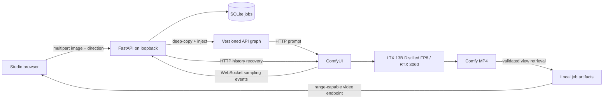

# OpenCinema Studio

A local cinematic image-to-video workspace powered by **real ComfyUI workflows** and **LTX-Video 13B v0.9.8 Distilled FP8**. Upload a frame, describe a scene, choose camera inspiration, and render an MP4 on your GPU.


## Current configuration

The current application uses **LTX-Video 13B v0.9.8 Distilled FP8**
with ComfyUI on port 8189.

- GPU: NVIDIA RTX 3060 12 GB
- Output: 512 x 320, 25 frames, 24 fps
- Workflow: `workflows/ltx13b-api.json`
- Image input: `LoadImage` (node 1206)
- Prompt: `CLIPTextEncode` (node 6)
- Video output: `VHS_VideoCombine` (node 1336)
- Output format: H.264 MP4

The ComfyUI instance reports all 19 required node types as available.
Full end-to-end generation through the updated Studio frontend
has not yet been verified. The 13B workflow is memory-intensive;
the observed successful ComfyUI preview is not a performance benchmark.

Camera presets append descriptive prompt text rather than enforcing
deterministic camera paths.
## Windows setup

Prerequisites: Git, Python 3.11, and a working ComfyUI installation with the models below. Clone this repository to D: before running these commands.

Use a separate Python 3.11 environment for Studio. Do not install Studio packages into ComfyUI's environment or upgrade its PyTorch installation.

`requirements.txt` pins direct dependencies. For the exact dependency set validated in the fresh-clone audit, install `requirements-lock.txt` instead. See [final audit](docs/FINAL-AUDIT.md).

```powershell
cd D:\comguopensource
py -3.11 -m venv .venv
.\.venv\Scripts\python.exe -m pip install -r requirements.txt
```

The current workstation already has the application dependencies; `python -m uvicorn app.main:app --host 127.0.0.1 --port 8000` also works there.

### Models and workflow

The current checkpoint is:

`ltxv-13b-0.9.8-distilled-fp8.safetensors`

Install the checkpoint and its required text encoder, VAE
dependencies and custom nodes in ComfyUI according to their
respective upstream instructions and licenses.

The 13B workflow uses the ComfyUI LTXV nodes and
VideoHelperSuite (`VHS_VideoCombine`). It is not compatible
with the earlier 2B dependency list.

The production API graph is `workflows/ltx13b-api.json`.
The original 2B workflow is retained for reference.

Model weights are not included in this repository.
### Launch

Start ComfyUI first, using its existing environment. The script defaults to this workstation's Desktop installation and accepts `-ComfyRoot` for another installation:

```powershell
# Start the LTX 13B ComfyUI instance separately on port 8189
```

In a second terminal:

```powershell
cd D:\comguopensource
$env:COMFY_URL = "http://127.0.0.1:8189"
.\.venv\Scripts\python.exe -m uvicorn app.main:app --host 127.0.0.1 --port 8000 --workers 1
```

Open **http://127.0.0.1:8000**. Upload a PNG/JPEG/WebP up to 10 MiB and 20 megapixels. English descriptive prompts work with the tested workflow. Keep ComfyUI dedicated to Studio while rendering. The application rejects overlapping jobs; it does not maintain an unlimited queue. Other ComfyUI clients can still submit directly, so do not render concurrently from its own UI.

Optional environment variables: `COMFY_URL` (default `http://127.0.0.1:8188`; set it explicitly to `http://127.0.0.1:8189` for LTX 13B) and `OPENCINEMA_DATA` (default `artifacts/studio`). Keep the latter on D:. This is a trusted, single-user loopback application, not an authenticated public service. Run exactly **one worker** and do not expose it to the Internet.

## API and recovery

| Endpoint | Purpose |
| --- | --- |
| `POST /api/jobs` | Multipart `image`, `prompt`, `preset` (`dolly`, `orbit`, `crane`, `static`), `seed` (0–4294967295); returns 202 and job |
| `GET /api/jobs/{id}` | Persisted status, sampling progress, message, seed and Comfy prompt ID |
| `GET /api/jobs/{id}/video` | Job-owned MP4, supports HTTP ranges for playback |
| `GET /api/health` | ComfyUI reachability, device names, active job ID |

SQLite stores the active reservation before submission. HTTP history and queue polling recover state after WebSocket disconnection or backend restart. An ambiguous submission is reconciled using its job tag; it is never automatically resubmitted. If ComfyUI is offline, restart it and leave Studio open. If queue/history no longer contain the job, Studio reports failure and allows an explicit retry. Do not clear ComfyUI history during an active generation.

Progress is sampling progress (0–95%); 100% means an MP4 has been retrieved. Model loading and decoding have no reliable percentage. A completed result survives a browser refresh. No cancel endpoint, automatic disk cleanup or job gallery is implemented yet.

Inputs are decoded and re-encoded with Pillow; filenames are generated UUIDs. The backend validates the specific SaveVideo output before fetching it, then serves only its local copy. Request bodies, image dimensions, MIME types, presets, seeds and prompt lengths are bounded. Cross-origin POSTs and unknown Host headers are rejected.

## Tests

```powershell
.\.venv\Scripts\python.exe -m pytest -q
```

Automated tests use a fake Comfy service and do not consume GPU time. They cover upload validation, immutable graph injection, lifecycle, single-job reservation, restart reconciliation, operation without WebSocket, Comfy failures, safe output paths, range retrieval and HTTP guards. Actual browser/GPU verification is documented separately in [Phase 3 report](docs/phase-3-report.md).

## Architecture



Artifacts include normalized input, submitted workflow, history, sampled progress events and MP4. They live under ignored `artifacts/`; model weights are also ignored. UI screenshots are the only media explicitly allowed under `docs/screenshots/`. Do not commit generated videos or uploaded images. Demo media should be shared separately after confirming input rights.

## Hackathon

See [submission checklist and recording script](docs/SUBMISSION.md). The code is MIT; third-party workflows, models and example images retain their own terms. [Attribution](docs/ATTRIBUTION.md) explains the separation. No paid API, cloud inference or mock video is used.

### Reuse existing weights in another clone

Do not run the model downloader again. Keep the existing ComfyUI process running with its D: model configuration, then launch Studio from the new clone. Studio uploads inputs over HTTP and does not require a local copy of the weights. If restarting ComfyUI, set `base_path` in the clone's `config/extra_model_paths.yaml` to the existing model directory. No junction or copy is required.
